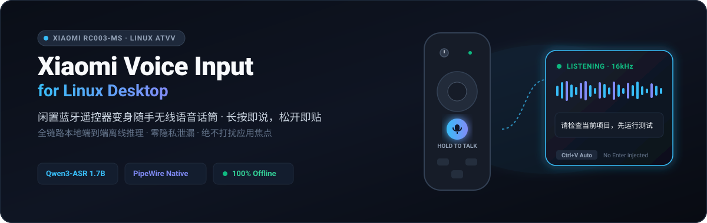
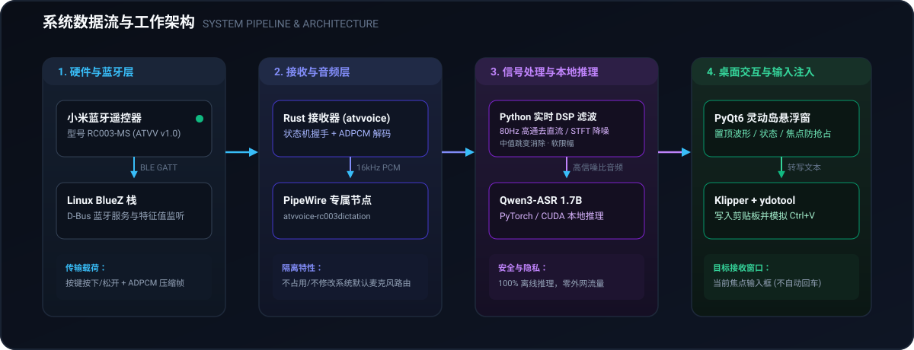
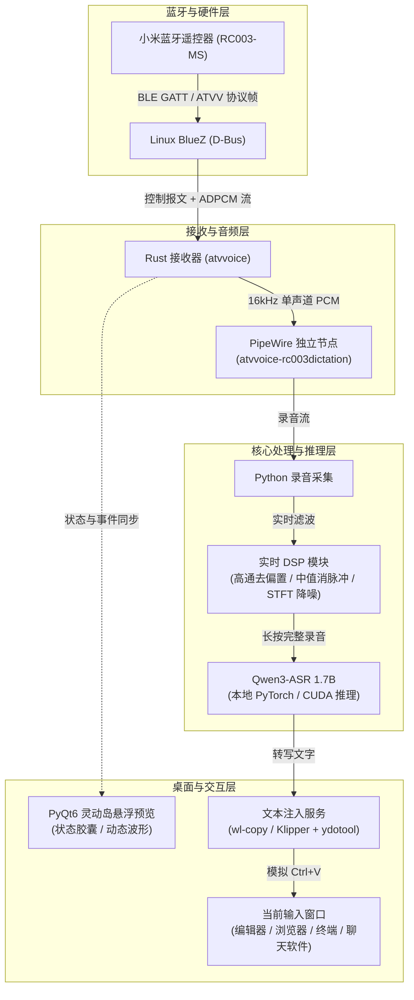
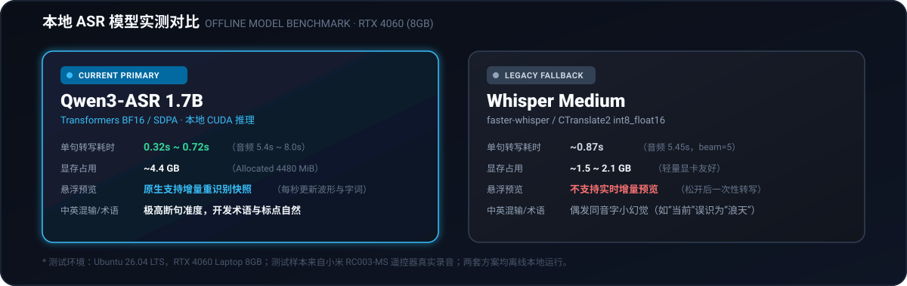

# Xiaomi RC003-MS Voice Input (Linux)

> 用手里闲置的小米电视蓝牙遥控器（型号 RC003-MS），在 Linux 桌面上做一套全局随手语音听写工具。

[](https://ubuntu.com/)
[](receiver/atvvoice/)
[](https://github.com/QwenLM)
[](FLOATING_PREVIEW.md)
[](LICENSE)

<p align="center">
  
</p>

按住遥控器语音键说话，屏幕上方会弹出一个仿灵动岛的黑色半透明悬浮胶囊，实时显示收音波形和当前状态；松开按键，本地大模型立刻开始识别，识别完成后自动通过剪贴板模拟 `Ctrl+V`，把文字打进你当前聚焦的窗口里。

**全链路本地离线推理，不依赖网络，不上传任何语音，隐私完全留在自己的电脑上。**

---

## 为什么做这个项目？

### 1. 随手口述，比键盘和桌面麦克风更自由
在写长篇技术方案、构思代码重构，或是向大模型倾倒长 Prompt 时，敲键盘时间长了手指和手腕容易酸痛。桌上的鹅颈麦要求必须端坐对着麦克风，戴耳机麦克风又觉得闷、有束缚感。
小米遥控器轻便小巧，拿在手里靠在工位椅背上、甚至站起来踱步时都能盲操。按住说话就像对讲机一样，思绪到哪里，文字就录到哪里。

### 2. 攻克 Android TV 蓝牙协议，把廉价遥控器盘活成专业话筒
小米等电视遥控器遵循 Google ATVV（Android TV Voice）协议，音频通过 BLE GATT 特征值传输 ADPCM 压缩数据。在 Linux 蓝牙栈下，系统默认只能识别它的方向键与音量键，根本录不到声音；而且原厂固件刚收音时带有严重的直流偏置与杂音爆音。
我们用 **Rust** 原生实现了 ATVV 协议握手、状态机维护与 ADPCM 解码，在 **PipeWire** 中建立专属的独立虚拟音频节点；再通过 **Python 实时 DSP**（80 Hz 一阶高通消除直流偏置 + 中值滤波平滑跳变 + STFT 噪声谱抑制），把几十块钱的闲置遥控器调教成了高信噪比的人声输入设备。

### 3. 彻底告别云端依赖，保护代码与日常隐私
主流商业语音输入法几乎都强制将音频上传到公有云。在日常编写核心业务代码、处理内部文档或私人沟通时，上传音频存在不可控的合规与隐私风险。
本项目全链路部署在本地，采用阿里巴巴开源的 **Qwen3-ASR 1.7B** 语音大模型（基于 PyTorch / Transformers 本地推理），对中英文混杂、专业术语断句都有极高准度，离线也能秒级转写。

### 4. 不抢焦点，不误发消息
很多第三方听写工具在弹出识别小窗时会夺取当前窗口的焦点，导致识别出的文字打不到原来的光标位置；还有些工具喜欢在打完字后自动按一次回车，极易在聊天软件中把还没修改完的草稿直接发送出去。
我们设计的灵动岛悬浮胶囊具备焦点穿透与防抢占机制（Focus Stealing Prevention），全程不抢鼠标和键盘焦点；转写完成后只更新系统剪贴板，并通过 `ydotool` 发送一次精准的 `Ctrl+V`，**绝不自动敲回车**，在 VSCode、终端、浏览器或各类聊天软件中都能稳定使用。

---

## 系统架构与工作链路

<p align="center">
  
</p>

<details>
<summary>点击展开原始数据流拓扑 (Mermaid)</summary>



</details>

---

## 本地 ASR 模型实测与选型

项目主推 **Qwen3-ASR 1.7B**，同时在架构中保留 **Whisper medium** 作为轻量备用方案。以下为在 RTX 4060 Laptop (8GB) 实机环境下，基于小米 RC003-MS 遥控器真实音频录音的同源离线对比：

<p align="center">
  
</p>

- **为什么主选 Qwen3-ASR 1.7B**：在中文开发术语（如函数名、缩写、技术名词）和自然语序断句上表现优异，极少出现同音字小幻觉；且支持高频的增量快照重识别，是驱动桌面灵动岛悬浮波形与动态文字预览的核心。
- **Whisper medium 的定位**：显存占用较小（约 1.5 ~ 2.1 GB），适合显存较为紧张的机器作为降级备用，但仅支持松开按键后单次离线转写。

---

## 技术栈一览

| 模块 | 核心技术 / 组件 | 承担职责 |
| :--- | :--- | :--- |
| **底层与音频** | Linux BlueZ, D-Bus, PipeWire 0.3+ | 负责 BLE 蓝牙通信、服务发现及音频路由管理 |
| **协议接收器** | Rust (2021), tokio, pipewire-rs, dbus | 逆向实现 ATVV 协议、状态机同步与 ADPCM 音频流解码 |
| **信号处理** | Python 3.12, NumPy, SciPy | 实时音频捕获、直流偏置滤除、STFT 噪声谱估计与软限幅 |
| **语音识别** | Qwen3-ASR 1.7B, PyTorch, Transformers | 本地离线神经网络推理，输出带标点的精准文本（保留 Whisper medium 备用） |
| **桌面交互** | PyQt6, Qt Offscreen / Wayland | 极简半透明黑色胶囊悬浮窗，防抢焦设计，提供状态动效与音波能量柱 |
| **文本模拟** | ydotool, wl-clipboard, KDE Klipper | 跨 Wayland / X11 写入系统剪贴板并模拟组合键自动粘贴 |

---

## 硬件与运行环境要求

- **操作系统**：Ubuntu 26.04 LTS 或其他 Linux 发行版（内核 6.x+，Wayland 或 X11 环境）。
- **音频系统**：PipeWire（包含 `pipewire-pulse` 兼容模块）。
- **GPU 建议**：具备 NVIDIA 显卡（支持 CUDA，推荐 8GB 显存以上，如 RTX 4060），可确保 1.7B 模型毫秒级响应。
- **硬件设备**：小米电视/盒子原装蓝牙语音遥控器（背面型号为 **RC003-MS**）。

---

## 快速上手

### 1. 配对蓝牙遥控器
1. 打开系统蓝牙设置界面。
2. 同时按住遥控器上的「主页键 + 菜单键」直到指示灯闪烁，进入配对状态。
3. 在系统蓝牙列表中点击配对并连接。
4. 首次使用前按一下遥控器任意方向键，唤醒蓝牙连接通道。

### 2. 准备运行环境
详细的编译与本地环境恢复步骤，请查阅 [本地构建与运行指南 (BUILD_RUN.md)](BUILD_RUN.md)。
- 安装 Python 依赖：`pip install -r streaming-requirements.txt`
- 将 Qwen3-ASR 1.7B 模型文件放置于本地运行目录。

### 3. 一键启动
在仓库根目录直接运行主脚本：

```bash
bash start_streaming_dictation.sh
```

如需显式指定新构建的 Rust 接收器二进制：

```bash
bash start_streaming_dictation.sh --receiver "$PWD/artifacts/receiver-build/target/debug/atvvoice"
```

### 4. 听写使用体验
1. 终端或悬浮窗显示 **`READY`** 即表示系统已就绪。
2. 鼠标点击你想输入的文本框（例如代码编辑器、网页或聊天输入框）。
3. **按住遥控器语音键说话**，桌面中央会展开绿色的录音波形胶囊。
4. **说完了松开按键**，系统会自动保留约 900 ms 尾音避免吞字，随后进行快速识别并自动执行 `Ctrl+V` 将文字贴入窗口中。

---

## 仓库结构

```text
├── assets/                        # GitHub README 视觉资产 (纯 SVG 原生卡片与图表)
├── start_streaming_dictation.sh   # 主入口：启动 Qwen 语音识别与灵动岛悬浮服务
├── start_dictation.sh             # 备用入口：启动 Whisper 语音听写服务
├── toggle_dictation.sh            # 桌面快捷启停脚本
├── receiver/                      # Rust 编写的 ATVV 协议接收器源码 (atvvoice crate)
│   └── atvvoice/src/              # 包含 BLE、D-Bus、PipeWire 音频通道及 ADPCM 解码实现
├── streaming_dictation.py         # 听写主控服务：管线生命周期调度与状态机
├── streaming_asr.py               # Qwen3-ASR 模型加载与推理封装
├── audio_filter.py                # 实时音频 DSP 滤波管线 (高通/中值/STFT)
├── floating_preview.py            # PyQt6 灵动岛悬浮预览桌面端
├── streaming_preview.py           # 本地 HTTP 预览状态与通信接口
├── build_receiver.sh              # 接收器局部构建与编译辅助脚本
└── docs & specs/                  # 专题技术与排错文档（见下节）
```

---

## 专题文档与深入参考

为了让主文档保持清爽，各个维度的实现细节与排错记录已归档至独立文档中：

- 🛠️ [本地构建与运行指引 (BUILD_RUN.md)](BUILD_RUN.md)：Rust 局部 Sysroot 准备、D-Bus 动态链接、Python 虚拟环境恢复与 Systemd 临时单元托管。
- 🎙️ [流式听写架构设计 (STREAMING.md)](STREAMING.md)：Qwen 核心依赖清单、录音分块处理与推理性能评测数据。
- 🖥️ [灵动岛悬浮预览规范 (FLOATING_PREVIEW.md)](FLOATING_PREVIEW.md)：PyQt6 胶囊动效、能量柱绘制与 Wayland 下非抢占焦点的实现细节。
- 🔍 [接收器修复与协议分析 (RECEIVER_FIX.md)](RECEIVER_FIX.md)：ATVV 1.0 协议包重放、AUDIO_START 状态机复位与时钟同步修复过程。
- 📊 [ASR 选型与对比报告](report_asr_comparison.py)：Qwen3-ASR 与 Whisper medium 在遥控器音频条件下的 CER / 延迟横向对比。
- ⚖️ [开发与审查规范 (AGENTS.md)](AGENTS.md)：环境边界、红线操作约束与测试验证准则。

---

## 开源协议

本项目接收器子模块及相关代码遵循各子目录指定的开源许可协议（包括 Apache 2.0 / MIT）。详见各子目录说明。
