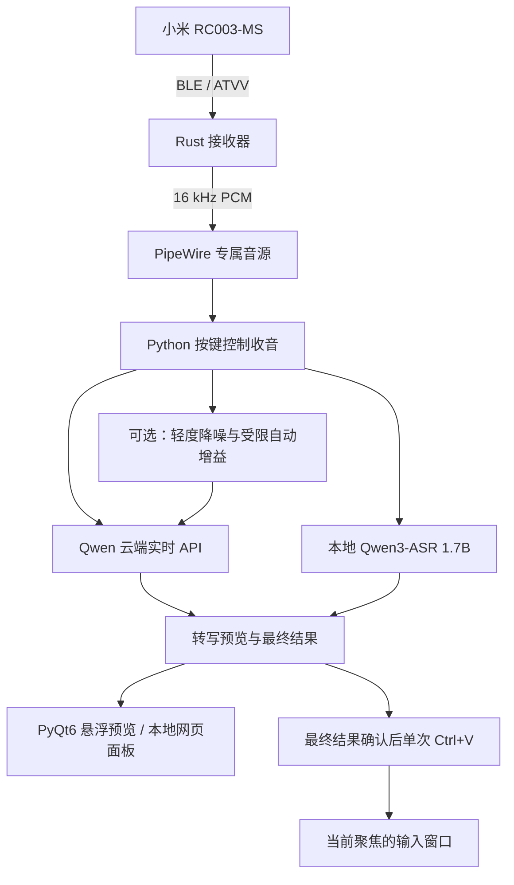

# Xiaomi RC003-MS Voice Input (Linux)

用小米 RC003-MS 蓝牙遥控器，在 Linux 桌面上按住说话、松开输入。

[](BUILD_RUN.md)
[](receiver/atvvoice/)
[](BUILD_RUN.md)
[](FLOATING_PREVIEW.md)

按住语音键时，悬浮胶囊显示收音状态和转写预览。松开后，系统确认最终文字并立即更新面板，再通过 KDE Klipper 和 ydotool 模拟一次 `Ctrl+V`，输入当前聚焦的窗口；不会自动发送回车。粘贴流程完成前显示“识别完成”，完成后才显示“已输入”。

**默认使用 Qwen 云端实时 API。** 本次按住期间及松键后的 300 ms 尾音会上传至阿里云，并按服务商规则计费；未按住时不上传遥控器音频。需要离线使用时，显式选择 `--backend local`，在本机运行 Qwen3-ASR 1.7B。

## 识别模式

| 模式 | 启动方式 | 音频去向 | 运行要求 |
| --- | --- | --- | --- |
| Qwen 云端实时识别（默认） | `--backend qwen-api` | 按住和尾音期间增量上传，每段只发送一次 | 网络、对应地域的 API Key，不需要本地 GPU 模型 |
| 本地 Qwen3-ASR 1.7B | `--backend local` | 本地推理，不上传 | 恢复本地模型和 Python 环境，建议 NVIDIA CUDA 显卡 |
| 本地 Whisper medium | `start_dictation.sh` | 本地推理，不上传 | 单独恢复 Whisper 环境和模型 |

云端连接或识别失败会取消本句，不自动重传、不粘贴草稿，也不自动切换到本地模型。几套入口不能同时控制同一个遥控器。

## 收音与输入链路

接收器通过 BlueZ 和 ATVV 协议读取遥控器音频，将 ADPCM 解码成 16 kHz 单声道 PCM，并在 PipeWire 中建立专属音源。收音程序绑定这一音源，不回退到系统默认麦克风。



云端在松键后保留 **300 ms** 尾音；本地 Qwen 模式仍保留 **900 ms**。缩短尾音减少了固定等待，但字尾完整性仍需在实际遥控器上验证。最终响应时间还受网络、服务端处理和桌面输入流程影响。

悬浮窗按不抢焦点设计，转写目标取决于最终粘贴时哪个窗口获得焦点。不同桌面和应用的表现需要单独验收，尤其是终端和聊天输入框。

## 可选音频增强

云端模式支持 `--audio-processing light`，默认关闭。该选项在上传前依次进行轻度频谱降噪、受限自动增益和峰值限制，用于尝试改善轻声及稳定背景噪声下的输入：

- 降噪掩码最多衰减约 6 dB，保护突出的窄带音调，不用硬门限直接切断轻声。
- 自动增益最高 +12 dB，只有电平高于近期背景估计时才逐渐增加；峰值限制约为 −2 dBFS。
- 每次按住重置处理状态，增加 10 ms 算法前瞻；结束时补齐滤波尾部，保持采样数和时长。
- 原始录音继续保存；增强模式成功识别后，另存对应实际上传内容的 `NNN.processed.wav`，便于对比。

这不是说话人分离算法，不能保证消除同事说话等交叠人声。连续轻声可能得不到明显增益；电平提高、听起来更干净，都不能代替错字和漏字的实际比较。参数说明和离线试听命令见 [BUILD_RUN.md](BUILD_RUN.md#可选轻度降噪与受限自动增益)。

## 快速上手

### 1. 准备设备和基础依赖

当前工作环境为 Ubuntu / KDE，依赖 BlueZ、PipeWire、KDE Klipper、ydotool 以及 input-remapper；其他桌面需要自行适配剪贴板与输入路径。本地 Qwen 1.7B 建议使用至少 8 GB 显存的 NVIDIA 显卡，实际可用空间还取决于桌面及其他程序；云端模式不要求 CUDA。

先在系统蓝牙设置中配对 RC003-MS，再按任意方向键唤醒设备。接收器构建、ydotool 工具及系统 PyQt6 的准备方法见 [BUILD_RUN.md](BUILD_RUN.md)。源码仓库不包含模型、虚拟环境、接收器构建产物或密钥。

### 2. 准备云端 Python 环境

在仓库根目录执行：

```bash
python3 -m venv artifacts/cloud-asr/venv
artifacts/cloud-asr/venv/bin/python -m pip install -r cloud-requirements.txt
```

### 3. 一键安装与配置（推荐）

本项目提供统一的配置与诊断工具 `configure.py`，用于一键完成密钥绑定、桌面图标安装与按键映射：

```bash
# 1. 导入百炼 API Key（保存至 ~/.config/mi-voice/api.key，权限 600）
python3 configure.py setup-key

# 2. 一键安装桌面快捷方式、启动入口与 12 键物理按键映射
python3 configure.py setup-all

# 3. 诊断当前系统环境与就绪状态（支持 --json 机器可读诊断）
python3 configure.py status
```

也可根据需要执行分步操作：
- `python3 configure.py setup-desktop`：仅安装/更新桌面快捷方式与 `~/.local/bin/mi-voice` 启动入口；
- `python3 configure.py setup-keymap`：仅将按键预设部署到 input-remapper 并启用用户自启服务；
- 终端临时运行亦可直接 `export DASHSCOPE_API_KEY="你的Key"`。

默认模型为 `qwen3-asr-flash-realtime`，地域为北京。新加坡账号需加 `--qwen-region singapore` 并使用对应地域的密钥。API Key 仅从环境变量或私有文件读取，不写入源码、日志或回执。

### 4. 启动听写

#### 桌面快捷方式（日常推荐）

双击桌面的 **MI 语音输入** 图标，弹出原生模式选择窗口：
- **云端实时语音**：自动读取 `~/.config/mi-voice/api.key`，免显存，松手秒出字；
- **本地离线模型**：纯本地推理，不消耗网络，需显存；
- 点击后自动在后台拉起服务与悬浮窗；如需退出，双击桌面的 **关闭 MI 语音服务** 即可彻底停止。

#### 命令行启动

使用默认配置与已构建接收器：

```bash
bash start_streaming_dictation.sh --backend qwen-api
```

要启用轻度降噪和自动增益，先安装可选依赖，再带参数启动：

```bash
artifacts/cloud-asr/venv/bin/python -m pip install -r audio-enhancement-requirements.txt
bash start_streaming_dictation.sh --backend qwen-api --audio-processing light \
  --receiver "$PWD/artifacts/receiver-build/target/debug/atvvoice"
```

启动参数不会热更新。已有实例运行时，先正常停止并确认其接收器、录音和键盘子进程退出，再切换配置；不要重复启动。回退使用 `--audio-processing off`。

恢复本地模型与环境后，可改用离线模式；本地模式暂不支持上述增强选项：

```bash
bash start_streaming_dictation.sh --backend local \
  --receiver "$PWD/artifacts/receiver-build/target/debug/atvvoice"
```

### 5. 实际使用与验收

1. `PCM_READY` / `READY` 表示本地收音链路准备完成，云端鉴权和转写仍需实际按住说话后验证。
2. 点击一个临时输入框，按住遥控器语音键说话，观察预览。
3. 说完后松键，确认面板先显示最终文字，输入框只收到一次粘贴，没有自动回车。
4. 分别用正常音量、小声和办公室背景声测试，检查错字、漏字、字尾和延迟。

## 录音、隐私与验证范围

原始 WAV、转写 TXT 和 JSON 回执保存在被 Git 忽略的 `artifacts/streaming-runtime/sessions/`。这些文件可能包含口述的私人内容，不应随源码提交或公开。增强模式只上传处理后的本次音频，不另行上传原始录音用于二次识别；失败不重传。

当前验证包括合成信号、云端协议模拟、本机 WebSocket、状态机和 Qt 离屏测试。300 ms 尾音与增强参数是否适合你的声音和办公环境，需要真实设备验收，不能由测试通过推定准确率提升。

回执中的 `release_to_final_result_seconds` 记录松键到最终结果可用的时间；`release_to_paste_flow_seconds` 还包括粘贴和剪贴板恢复。它们不等同于文字实际出现在屏幕上的时刻。

早期本地 Qwen 与 Whisper 的对比保存在 [本地模式实现与历史验收](STREAMING.md) 和 [对比报告生成脚本](report_asr_comparison.py) 中。历史样本和配图不代表当前云端模式的速度或准确率。

## 主要文件

| 文件 | 用途 |
| --- | --- |
| `start_streaming_dictation.sh` | 云端 / 本地 Qwen 入口及悬浮窗启动 |
| `configure.py` | 统一配置、桌面部署、按键映射与 Agent 诊断工具 |
| `launcher_dialog.py` | 桌面快捷方式的 PyQt6 模式选择弹窗 |
| `streaming_dictation.py` | 按键收音、尾音、最终结果与粘贴流程 |
| `streaming_qwen.py` | 云端 WebSocket、单次增量上传和结果合并 |
| `streaming_asr.py` | 本地 Qwen 模型与推理 |
| `audio_enhancement.py` | 云端可选降噪、自动增益及离线试听工具 |
| `audio_filter.py` | 独立的固定噪声谱滤波工具，不默认接入听写链路 |
| `floating_preview.py` | PyQt6 悬浮预览 |
| `receiver/atvvoice/` | Rust ATVV 接收器源码 |

## 进一步阅读

- [构建与运行](BUILD_RUN.md)：运行资产恢复、云端配置、增强选项及启动检查。
- [本地模式实现与历史验收](STREAMING.md)：本地推理和早期性能记录。
- [悬浮预览](FLOATING_PREVIEW.md)：浮窗交互与焦点行为。
- [按键映射](KEYMAP.md)：设备名兼容及相关配置。
- [已知问题与审查记录](REVIEW.md)：尚未解决的限制。
- [开发规范](AGENTS.md)：操作边界与验证要求。

## 开源协议

接收器及相关代码的许可范围以各子目录中的许可证文件为准。
