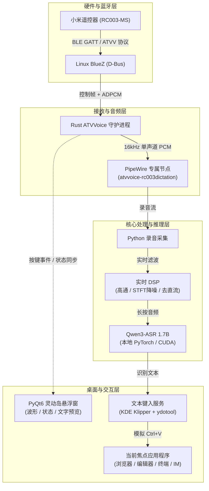

# Xiaomi RC003-MS Voice Input (Linux)

将小米电视/盒子蓝牙语音遥控器（型号 **RC003-MS**，基于 Android TV Voice / ATVV 协议）转化为 Linux 桌面下的全局无线语音听写设备。

按住遥控器语音键说话，桌面即时唤起灵动岛风格的半透明胶囊浮窗展示收音波形与识别状态；松开按键后，本地神经语音大模型自动转写，并通过剪贴板及模拟快捷键将文字精准键入到当前聚焦的任意应用程序输入框中。全程本地离线推理，不依赖云端，不泄露语音隐私。

---

## 解决的痛点与实际价值

1. **Linux 桌面缺失无缝的随手语音输入体验**
   - **痛点**：macOS 和 Windows 均内置全局语音听写快捷键，而 Linux（尤其在 Wayland / KDE / GNOME 复杂环境下）一直缺乏开箱即用、全局可用的语音输入方案；传统桌面鹅颈麦或耳机麦克风需要固定姿态或始终佩戴，不够自由随手。
   - **价值**：利用闲置或低成本的小米电视蓝牙遥控器，实现**随手拿取、盲操按住即说**。无论靠在椅背、离开工位还是仰躺沉思，都可以像使用对讲机一样随心口述输入。

2. **Android TV 蓝牙遥控器私有协议无法直接在 Linux 下收音**
   - **痛点**：小米遥控器采用 Google ATVV (Android TV Voice) 规范与私有 BLE GATT 传输 ADPCM 压缩音频，Linux 蓝牙栈默认只能将其识别为基础按键，无法作为系统录音麦克风；且硬件初段音频常带有极大的直流偏置与突发爆音。
   - **价值**：通过 Rust 原生逆向并实现完整的 ATVV 状态机解码，挂载专属 PipeWire 虚拟声卡节点，结合 Python 实时 DSP（80Hz 高通去偏置 + STFT 噪声抑制），将廉价遥控器盘活为高信噪比近场无线话筒。

3. **云端语音 API 的隐私外泄与断网不可用**
   - **痛点**：主流商用输入法普遍强制上传语音到公有云，在编写核心代码、内部技术方案、敏感沟通或完全离线/内网环境下存在巨大合规与隐私风险。
   - **价值**：全链路**完全离线本地部署**。依托本地强大的 **Qwen3-ASR 1.7B** 模型，利用本地 GPU/CPU 进行端到端推理，中英文混输精准断句，音频与文本不离本机。

4. **输入窗口被干扰与抢占焦点 (Focus Stealing)**
   - **痛点**：第三方听写软件往往需要弹出独立输入框，容易破坏目标窗口焦点；或者自动模拟发送 `Enter` 键，极易在聊天软件中误发未编辑完成的半成品语句。
   - **价值**：灵动岛胶囊仅作为状态与波形指示，通过系统级非抢占机制保持目标窗口激活；识别完成后通过剪贴板 + `ydotool` 只执行单次精准 `Ctrl+V` 粘贴，绝不自动注入回车，无缝适配任何 IDE、终端、浏览器及 IM 工具。

---

## 适用场景

- **AI 大模型 Prompt 深度对话**：向 Claude / ChatGPT / 本地大模型倾倒长篇背景、复杂需求与发散性思考，免去繁重的键盘打字。
- **技术文档与 Markdown 快速起草**：撰写设计方案、博客、会议记录或复盘总结时，口述成文，配合本地大模型的标点与断句能力，事半功倍。
- **长时间写代码后的手部疲劳放松**：在手腕疲劳或需要构思重构方案时，靠在椅背上手持遥控器直接口述代码注释、TODO 或架构思路。
- **各类桌面 IM / 邮件日常沟通**：在 Slack、微信、Telegram 或邮件客户端中进行日常长消息输入。

---

## 核心特性

- **硬件原生集成**：基于 Linux BlueZ 蓝牙栈与 ATVV v1.0 协议，支持 RC003-MS 遥控器的一键唤醒、按键状态监听与 ADPCM 音频流抓取。
- **独立音频通道**：Rust 接收器在 PipeWire 中创建专属虚拟声卡节点（`atvvoice-rc003dictation`），收音过程不占用、不篡改系统默认麦克风与音频路由。
- **实时数字信号处理 (DSP)**：采用 80 Hz 高通去直流偏置、中值滤波突发跳变消除、短时傅里叶变换 (STFT) 噪声谱抑制与软限幅，大幅改善蓝牙低采样率人声质量。
- **高精度本地 ASR**：主推 **Qwen3-ASR 1.7B** 语音大模型（基于 PyTorch / Transformers 本地推理），识别准确率高、中文断句及中英混杂能力强；同时保留 **Whisper medium** 降级选项。
- **灵动岛桌面悬浮预览**：基于 PyQt6 实现极简黑色半透明胶囊交互，自动显示准备就绪、按住收音、正在识别及转写文本预览。窗口置顶且不抢占系统输入焦点（Focus Stealing Prevention）。
- **通用文本键入**：借助系统剪贴板（Wayland wl-copy / KDE Klipper）与虚拟输入设备（ydotool）发送 `Ctrl+V`，只输入文字，不发送多余的 `Enter`，避免误触发消息发送。

---

## 系统架构与工作链路



---

## 技术栈

| 层次 | 核心技术 / 组件 | 作用说明 |
| :--- | :--- | :--- |
| **系统底层** | Linux BlueZ, D-Bus, PipeWire 0.3+ | 蓝牙外设管理、GATT 协议通信与音频流传输 |
| **设备接收** | Rust, tokio, pipewire-rs, dbus | 高性能低延迟 ATVV 协议解包与专属音频通道维护 |
| **信号处理** | Python 3.12, NumPy, SciPy | 实时音频采集、直流偏置滤除、STFT 谱减降噪与波形平滑 |
| **语音识别** | Qwen3-ASR 1.7B, PyTorch, Transformers, CUDA | 本地离线大模型推理，支持流式与离线转写 |
| **用户界面** | PyQt6, Qt Offscreen / Wayland | 极简无边框悬浮胶囊 UI，自适应状态动效与音频能量柱显示 |
| **输入模拟** | ydotool, wl-clipboard, KDE Klipper | 跨 Wayland / X11 剪贴板自动写入与组合键模拟注入 |

---

## 硬件与系统要求

- **操作系统**：Ubuntu 26.04 LTS / Debian 系列（内核 6.x+，测试于 x86_64 平台）。
- **音频系统**：PipeWire（含 `pipewire-pulse` 兼容层）。
- **GPU 推荐**：NVIDIA 显卡（支持 CUDA，如 RTX 4060 / 8GB 显存），以保证 1.7B 模型毫秒级响应。
- **硬件设备**：小米电视/电视盒子蓝牙语音遥控器（型号确认背部铭牌为 **RC003-MS** 或同系 ATVV 规范遥控器）。

---

## 快速上手

### 1. 遥控器配对与准备
1. 打开系统蓝牙设置，长按遥控器「主页键 + 菜单键」进入配对模式。
2. 在系统蓝牙设备列表中连接配对成功。
3. 首次使用前按一下遥控器任意方向键，唤醒蓝牙连接。

### 2. 依赖与环境准备
完整的编译与模型准备步骤请参阅 [本地构建与运行指南 (BUILD_RUN.md)](BUILD_RUN.md)。
- 安装 Python 依赖：`pip install -r streaming-requirements.txt`
- 准备 Qwen3-ASR 1.7B 模型文件至指定目录。

### 3. 一键启动
在仓库根目录执行主启动脚本：

```bash
bash start_streaming_dictation.sh
```

如需显式指定最新编译的原生 Rust 接收器：

```bash
bash start_streaming_dictation.sh --receiver "$PWD/artifacts/receiver-build/target/debug/atvvoice"
```

### 4. 听写操作
1. 观察控制台输出或桌面悬浮窗出现 **`READY`** 提示。
2. 鼠标点击任意想要输入文字的应用窗口（如文本编辑器、聊天框或浏览器输入框）。
3. **按住遥控器语音键说话**，悬浮窗将进入绿色录音与波形动态展示。
4. **说话完毕松开按键**，系统保留约 900ms 尾音后自动完成识别并执行 `Ctrl+V` 粘贴。

---

## 项目代码结构

```text
├── start_streaming_dictation.sh   # 主入口：启动 Qwen ASR + 灵动岛悬浮预览听写服务
├── start_dictation.sh             # 备用入口：历史 Whisper 听写服务
├── toggle_dictation.sh            # 桌面快捷启停与状态切换脚本
├── receiver/                      # Rust 编写的 ATVV 协议接收器源码 (atvvoice crate)
│   └── atvvoice/src/              # 包含 BLE、D-Bus、PipeWire 音频通道及 ADPCM 解码
├── streaming_dictation.py         # 听写主控服务：管线生命周期调度与状态机
├── streaming_asr.py               # Qwen3-ASR 模型加载与推理封装
├── audio_filter.py                # 实时音频 DSP 滤波管线 (高通/中值/STFT)
├── floating_preview.py            # PyQt6 灵动岛悬浮预览桌面端
├── streaming_preview.py           # 本地 HTTP 预览状态与通信接口
├── build_receiver.sh              # 接收器局部构建与编译辅助脚本
└── docs & specs/                  # 深度技术规格与排错文档（见下节）
```

---

## 专题文档与深入参考

为保持主文档凝练，特定维度的实现细节、排错与验收记录归档如下：

- 🛠️ [本地构建与运行指引 (BUILD_RUN.md)](BUILD_RUN.md)：Rust Sysroot 准备、D-Bus 动态库链接、Python 虚拟环境恢复与 Systemd 临时单元托管。
- 🎙️ [流式听写架构设计 (STREAMING.md)](STREAMING.md)：Qwen 依赖版本细节、录音切片策略与推理性能数据。
- 🖥️ [灵动岛悬浮预览规范 (FLOATING_PREVIEW.md)](FLOATING_PREVIEW.md)：PyQt6 胶囊动效、能量柱绘制与 Wayland 下非抢占焦点的实现细节。
- 🔍 [接收器修复与协议分析 (RECEIVER_FIX.md)](RECEIVER_FIX.md)：ATVV 1.0 协议包结构重放、AUDIO_START 状态机复位与时钟同步修复。
- 📊 [ASR 选型与对比报告](report_asr_comparison.py)：Qwen3-ASR 与 Whisper medium 在遥控器音频条件下的 CER / 延迟横向评测。
- ⚖️ [开发与审查规范 (AGENTS.md)](AGENTS.md)：环境边界、红线操作约束与测试验证准则。

---

## 许可证

本项目接收器子模块及相关代码遵循各子目录指定的开源许可协议（包括 Apache 2.0 / MIT）。详见各子目录说明。
